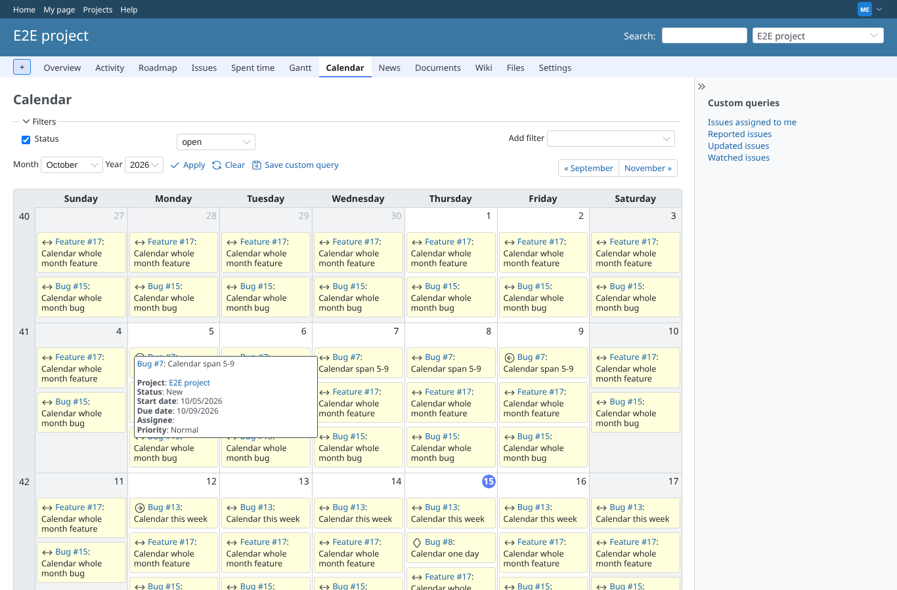
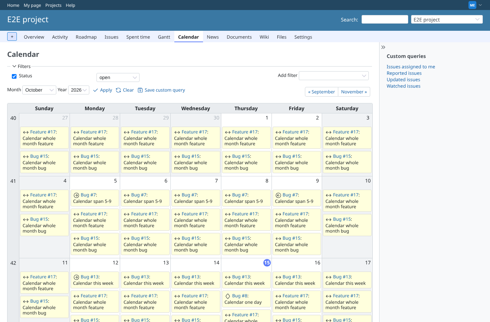
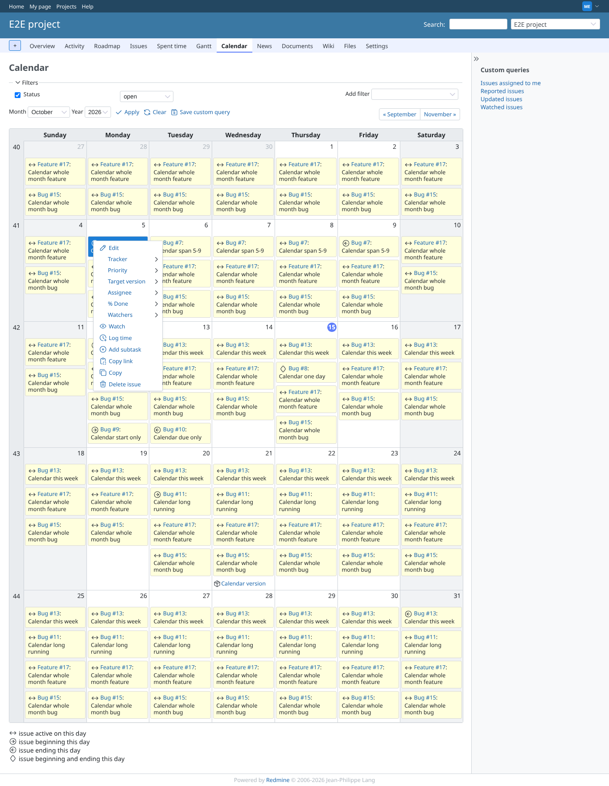
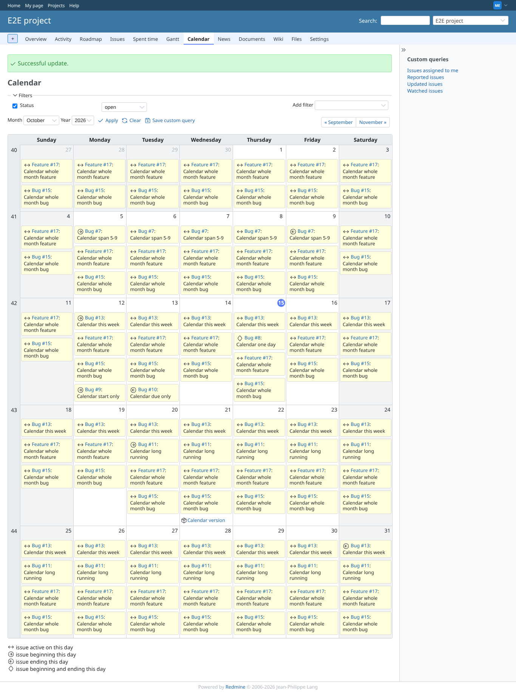
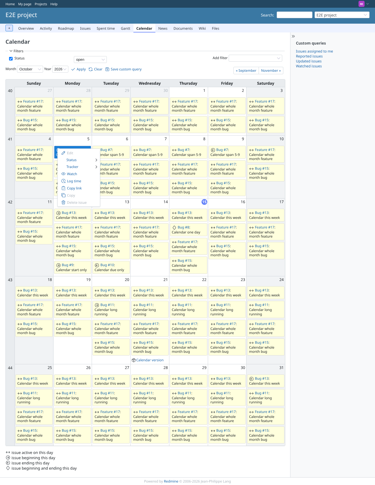

# context-menu

Run 2026-10-15T04:46:41.969Z against http://127.0.0.1:3000.

| screenshot | user | URL | shows |
|---|---|---|---|
|  | manager | `/projects/e2e-project/issues/calendar` | Manager: hovering the start-day entry shows the issue tooltip with start and due date |
|  | manager | `/projects/e2e-project/issues/calendar` | Manager: hovering a between entry shows no tooltip; the entry is the marker and the link (decision 2026-10-15) |
|  | manager | `/projects/e2e-project/issues/calendar` | Manager: right-click on the start-day entry opens the issue context menu with all actions |
|  | manager | `/projects/e2e-project/issues/calendar` | Manager: after "Priority > High" from the menu, the issue is back on the calendar on all its days |
|  | reporter | `/projects/e2e-project/issues/calendar` | Reporter: the context menu on the start-day entry greys out what the Reporter role may not do (Edit, Delete issue) |
