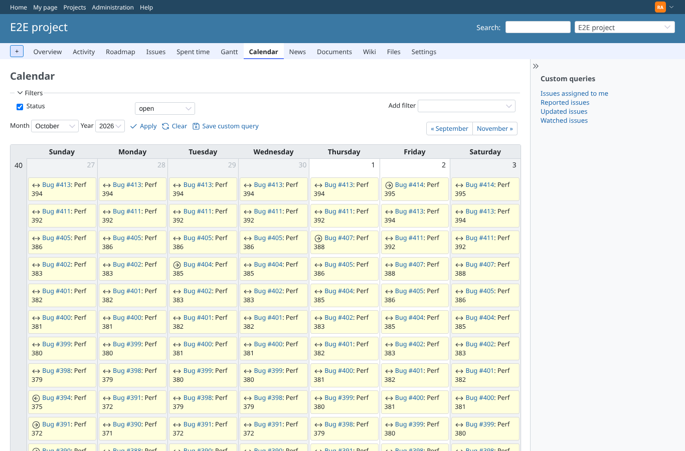
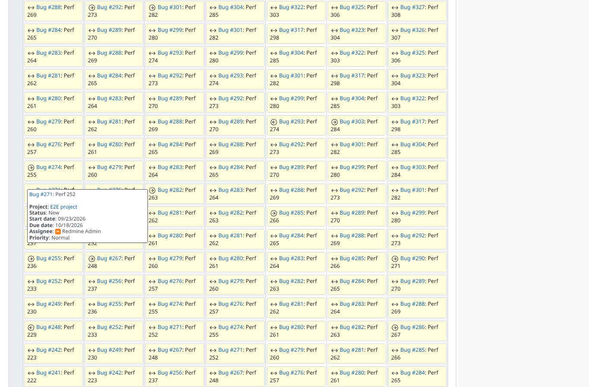

# perf-after

Run 2026-10-14T23:33:08.171Z against http://127.0.0.1:3000.

| screenshot | user | URL | shows |
|---|---|---|---|
|  | admin | `/projects/e2e-project/issues/calendar` | after: E2E project calendar with 400 multi-day issues, 6811 entries (6307 between), server 1149 ms, load event at 4037 ms |
|  | admin | `/projects/e2e-project/issues/calendar` | after: the tooltip of a between entry |
