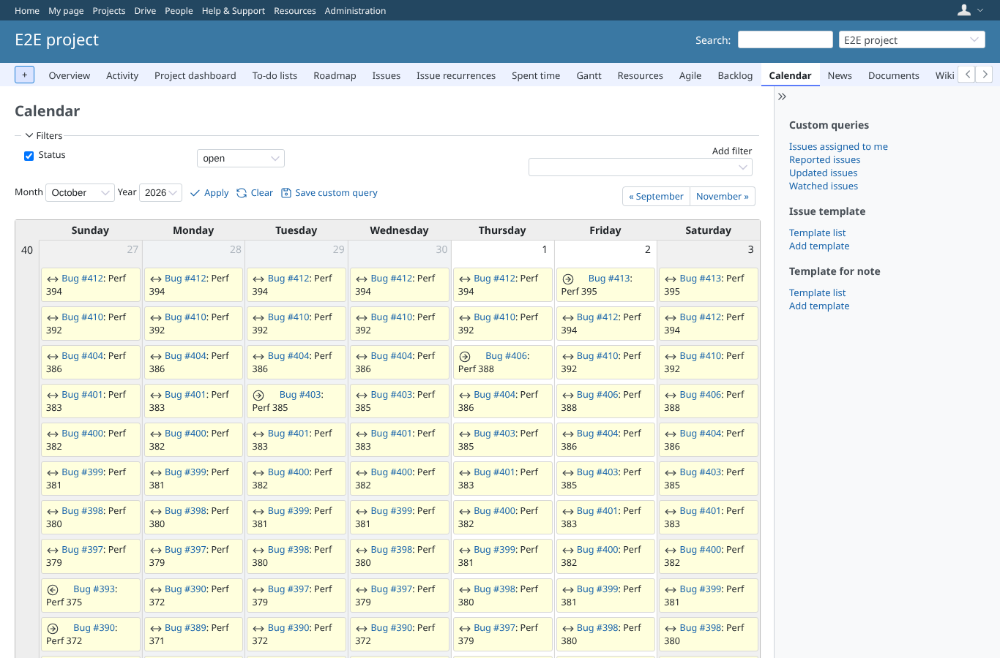
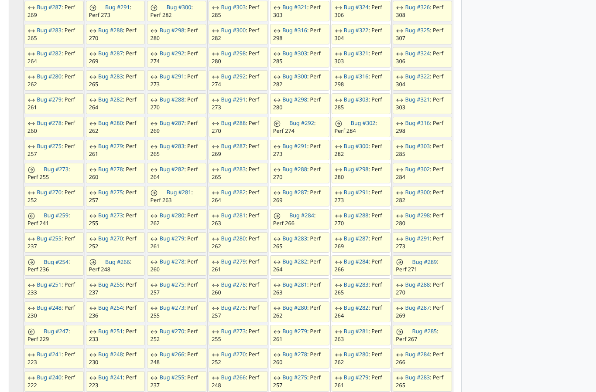
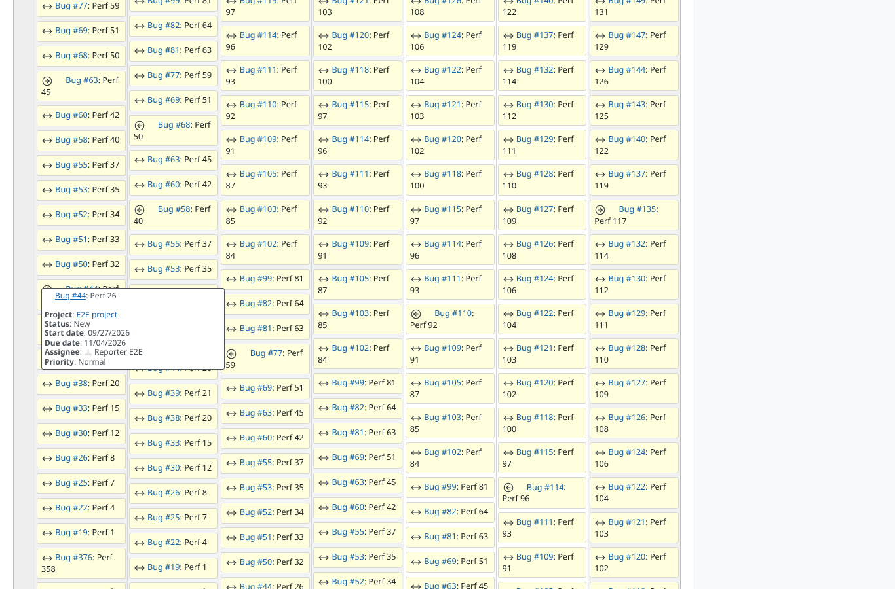

# perf-link-between

Run 2026-10-15T04:51:45.438Z against http://127.0.0.1:3002.

| screenshot | user | URL | shows |
|---|---|---|---|
|  | admin | `/projects/e2e-project/issues/calendar` | link-between: E2E project calendar with 400 multi-day issues, 6811 entries (6307 between), server 829 ms, load event at 2690 ms |
|  | admin | `/projects/e2e-project/issues/calendar` | link-between: hovering a between entry, no tooltip (just the link); 504 hidden tooltips in the page |
|  | admin | `/projects/e2e-project/issues/calendar` | link-between: hovering a start-day entry shows the issue tooltip |

## Problems

- /projects/e2e-project/issues/calendar as admin: 404 image /assets/plugin_assets/redmineup/bullet_end.png
- /projects/e2e-project/issues/calendar as admin: 404 image /assets/plugin_assets/redmineup/bullet_go.png
- /projects/e2e-project/issues/calendar as admin: 404 image /assets/plugin_assets/redmineup/bullet_diamond.png
